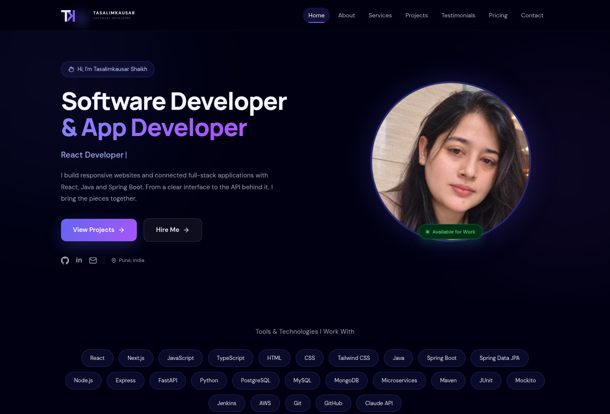
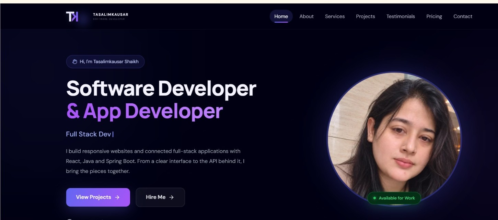
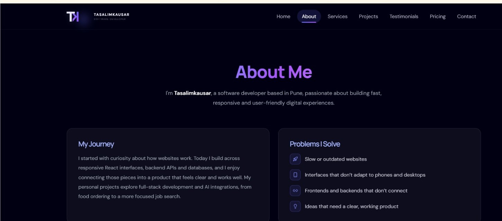
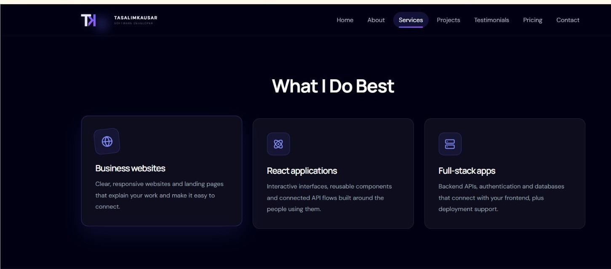
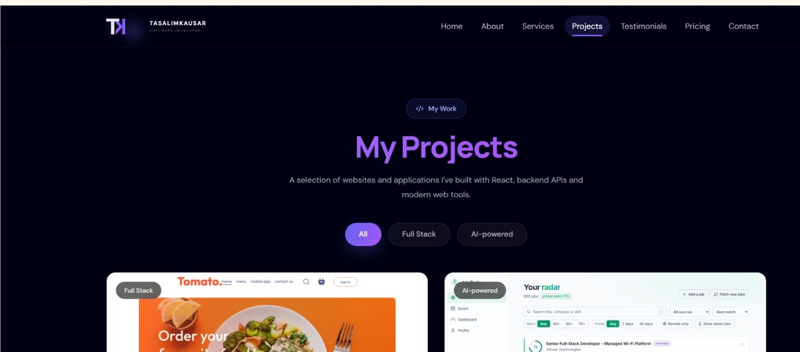
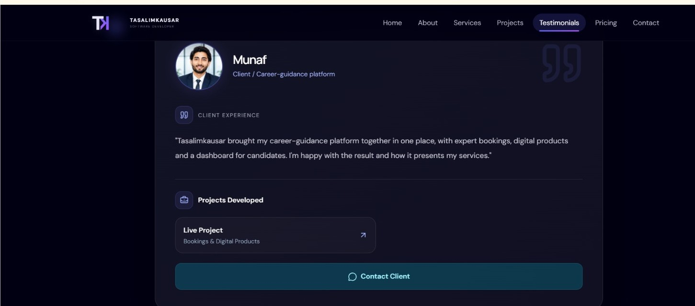
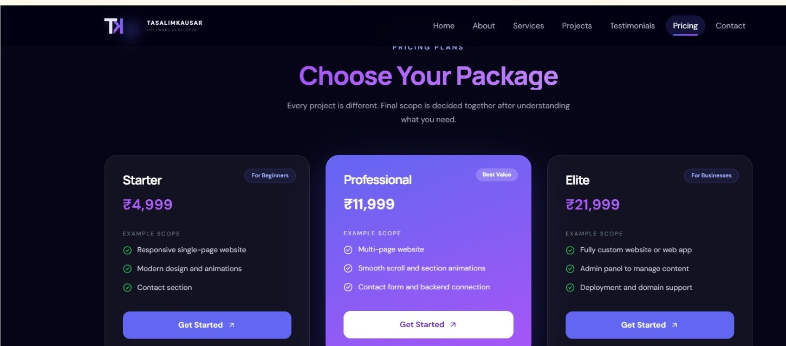
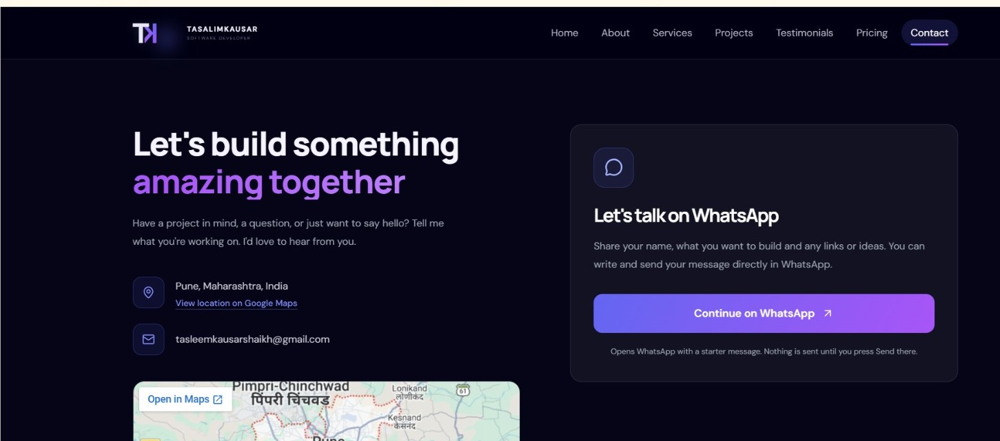
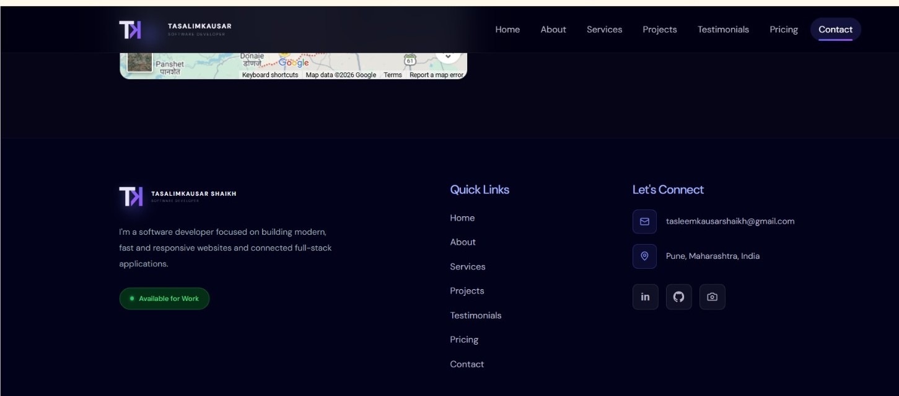

# Tasalimkausar Shaikh | Developer Portfolio

A responsive portfolio built with React and Next.js, with a dark violet design, smooth scrolling and a Supabase-backed owner editor.



## Page screenshots

These are the owner's local preview screenshots, cropped to remove browser tabs and address bars. The Projects screen below shows the original card layout; project clicks now open a details view with an explanation and live-site button.

### Home



### About



### Services



### Projects



### Testimonial



### Pricing



### Contact



### Footer



## Try the projects

| Project | What it does | Live website |
| --- | --- | --- |
| Tomato | Food menu, cart and ordering demo. Payments use test mode. | [Open Tomato](https://tomato-shop.duckdns.org/) |
| Job Radar AI | Resume-based job matching, AI fit analysis and application tracking. Sign-in required. | [Open Job Radar AI](https://job-radar-ai-m713.vercel.app/) |
| Live Project / Sessio | Expert bookings, digital guides and priority questions, with a candidate dashboard. | [Open Sessio](https://munaf-career.vercel.app/) |

All three landing pages were checked on November 24, 2026. This is not an end-to-end test of sign-in, booking, AI services or payments. Hosting availability can change. Do not enter real payment details to try a demo.

Click a project image, title or **View project details** to see how it works, technologies, screenshots and **View Live Website**. The live button opens the actual project in a new tab.

## About

I'm Tasalimkausar, a software developer based in Pune. I build responsive interfaces and connected full-stack applications with React, Java and Spring Boot.

This portfolio brings together my projects, skills, education, certificates, services and client feedback.

## What's inside

- Separate Home, About, Services, Projects, Testimonials, Pricing and Contact pages.
- Project cards with live links, filters and screenshot galleries.
- Tomato, Job Radar AI and a client booking/digital-products platform.
- Certificate PDF viewing and downloads.
- Munaf's confirmed testimonial and a Contact Client link.
- WhatsApp contact handoff, visitors review and send their message in WhatsApp.
- Owner-only `/admin` editor for projects, screenshots, gallery captions, skills and certificates.
- Responsive layouts, Motion animations and Lenis smooth scrolling.

## Built with

| Area | Technology |
| --- | --- |
| Interface | React, Next.js App Router |
| Styling | Tailwind CSS |
| Animation | Motion, Lenis |
| Icons | Lucide |
| Content and sign-in | Supabase Database, Auth and Storage |

## Run locally

Install a current Node.js LTS release. Node.js 22 was used for testing.

Open this project's folder in VS Code, then run:

```bash
npm install
npm run dev
```

Open the local address printed in the terminal, usually `http://localhost:3000`.

For a local production check:

```bash
npm run build
npm start
```

## Environment settings

The prepared source ZIP includes a `.env.local` file containing only the project URL and browser-safe Supabase publishable key. It is excluded from Git. If you cloned this repository instead, use `.env.example` to create your own `.env.local`:

```dotenv
NEXT_PUBLIC_SUPABASE_URL=your_project_url
NEXT_PUBLIC_SUPABASE_PUBLISHABLE_KEY=your_publishable_key
```

Use the publishable key only. Never commit account passwords, database passwords, service-role keys or secret API keys. For hosting, set the two variables in the hosting dashboard before building.

## Owner editor

Open `/admin` and use the separate portfolio-owner login. It is not the Supabase dashboard login.

Choose Projects, Skills or Certificates, make changes, then select **Save changes**. Uploads must be under 10 MB. Project images support JPG, PNG and WebP; certificates use PDF.

Only the allowlisted owner can save content or upload files. Visitors can read portfolio content. Public signup is disabled in the configured project. Removing a card does not delete its stored file, so existing links do not break.

Uploaded media can be viewed by anyone who has its link. Use only files intended for the portfolio and hide private details before uploading. Keep local backups.

## Project structure

```text
app/                 Pages, UI components and content
app/admin/           Owner sign-in and editor
public/assets/       Images, fonts and certificate PDFs
supabase/schema.sql  Database tables, access rules and storage setup
```

## Deployment notes

This repository uses a regular Next.js build, not a static `out` export. On Netlify, use the Next.js integration with `npm run build` and publish directory `.next`. Add both Supabase environment variables before the first build.

Publishing to GitHub does not make the website live. Hosting deployment is a separate step. Check current hosting plan and credit usage before publishing. Do not overwrite an existing portfolio unless that change is intended.

## Content and availability

Pricing amounts are owner-confirmed; package descriptions are example scope, not fixed delivery promises. The testimonial wording, portrait and client-contact permission were confirmed by the owner.

If the Supabase Free project is paused or unavailable, public pages fall back to the original bundled content. Database-only edits require the backend to be available.

## Connect

- [GitHub](https://github.com/tasleemk17)
- [LinkedIn](https://www.linkedin.com/in/tasleemkousar-inamdar/)
- [Instagram](https://instagram.com/tasalimx.websolutions)

Project code and photos are included for this portfolio. Font license notices are included with the assets. No general reuse license is granted for personal or client images.
